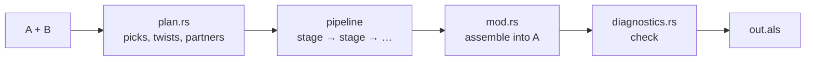
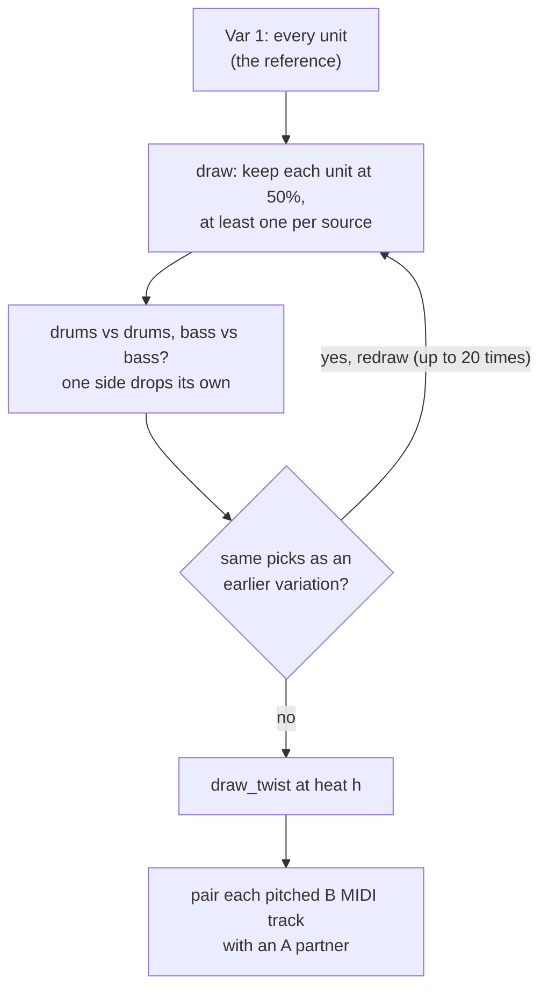
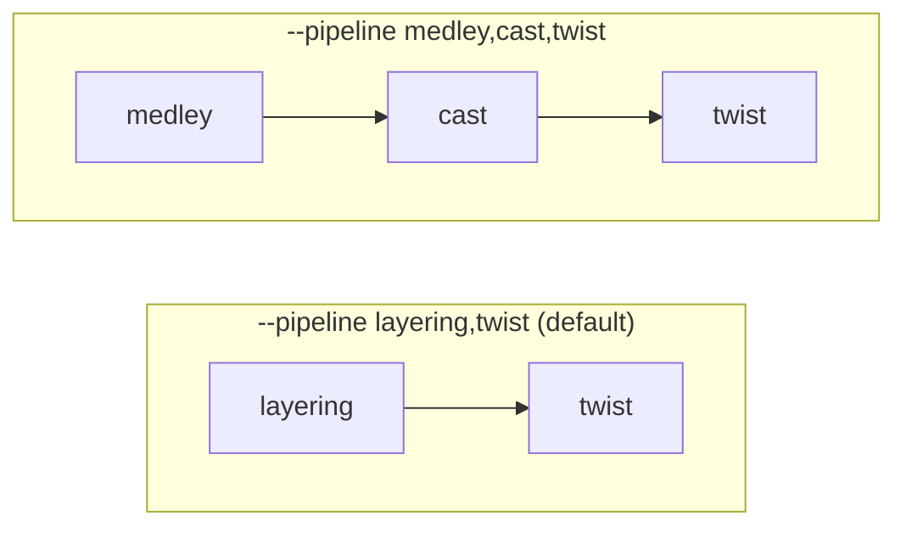
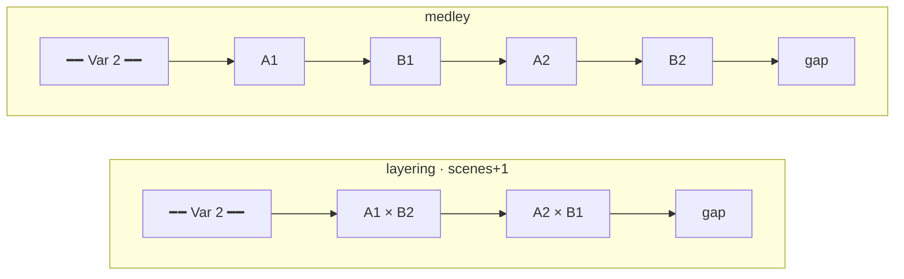
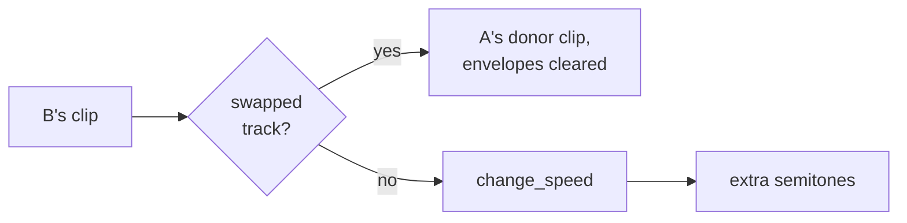
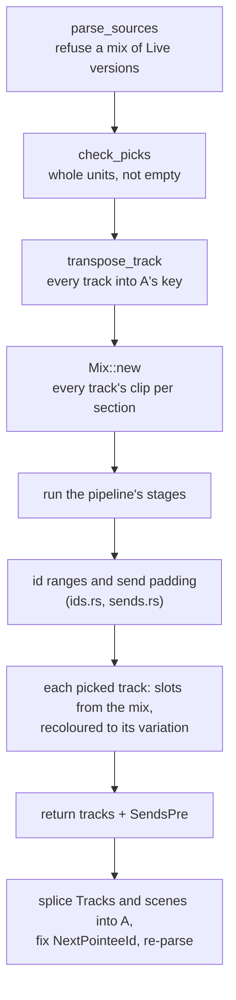

# mashup

Takes two Ableton Live sets, A and B, and writes one set with both. The
merged set has 1 to 6 **variations**, each a coloured block of Session
scenes playing a different mix of A's and B's tracks. B is moved into A's
key.

How A and B are combined is a **pipeline**: a list of stages, one per
paradigm, run in order. Every stage has the same interface, so a different
mashup is a different list of names: `layering,twist` (the default) or
`medley,cast,twist`.



- **Plan** makes every random choice and returns plain data. The same
  seed always gives the same plan.
- **The pipeline** turns that plan into scenes and clips.
- **Assemble** fits the result into one valid set (ids, sends, returns)
  and splices it into A's XML. It's the same whatever the pipeline was.
- **Check** catches every structural problem Live's loader has rejected
  so far.

The `mashup` and `mashup_batch_test` binaries take `--pipeline`. The app's
`mashup_create` command currently skips planning, builds one hand-picked
variation, and uses the default pipeline.

## Plan: what each variation does

`plan_variations(sources, categories, n, heat, seed)` returns one
`Variation` per block:

- **`picks[s]`**: the tracks it plays from source `s`. Picks are always
  whole **units**: a top-level track plus everything grouped under it.
- **`twist`**: the heat changes to B (see the `twist` stage below).
- **`partners`**: `(b, a)` pairs. Every picked, pitched B MIDI track is
  paired with one of A's pitched MIDI tracks. The stages that mix the two
  songs (cast, cutup, fuse) read these.

Var 1 is the reference: every unit, no twist and no partners.



Partners come from their own random stream, so adding them didn't change
any existing plan.

## The pipeline

Every paradigm module exports one stage:

```rust
pub trait Stage {
    fn run(&self, mix: &mut Mix) -> Result<()>;
}
```

`Mix` is the mashup while it's being built. For each variation, it holds a
`Block`:

- `rows`: which of A's and B's sections each scene plays.
- `slots`: the clip every picked track plays in each scene.

A stage reads the mix and reworks it. `parse_pipeline("medley,cast,twist")`
turns names into stages.



| Stage | Module | Question it answers | What it does |
|---|---|---|---|
| `layering` | layering.rs | when | A and B play together: B's section j + `scene_shift` over A's section j |
| `medley` | medley.rs | when | A and B take turns by section: A1, B1, A2, B2, … |
| `twist` | twist.rs | B's own clips | the heat changes: extra pitch, half/double speed, one swapped track |
| `cast` | cast.rs | who | each partnered B track plays its A partner's clip on B's instrument |
| `cutup` | cutup.rs | what | each partnered B track alternates bars: its own, then its partner's |
| `fuse` | fuse.rs | what | each partnered B track plays its partner's rhythm with B's pitches |

Rules for composing a pipeline:

- **A layout stage goes first.** `layering` or `medley` sets the rows and
  fills the slots that every later stage reworks. Without one,
  `build_mashup_with` refuses.
- **Stages that answer the same question clash.** `cutup` after `cast`
  alternates A's material with A's material. `fuse` then `cutup` works,
  but little of B is left to recognise.
- **Order matters.** `cutup,twist` stretches the cut-up result, while
  `twist,cutup` cuts up the stretched clip.
- **Partner stages only change scenes where the A partner plays.** In a
  medley, that means only A's turns.
- **`cutup` and `fuse` only handle MIDI.** An audio slot passes through
  unchanged.

To add a paradigm: write a module with one struct that implements `Stage`,
then add its name to `parse_pipeline` in pipeline.rs.

### Layout stages



Each variation gets a header scene, its scenes, and a gap. Layering gives
one scene per section of whichever source has more, up to 8. Medley gives
twice that, one turn each. Both sources wrap around when they run out of
sections. A track the variation doesn't pick stays silent in its scenes.

### The twist stage, per slot

`Twist::apply` runs on each of B's slots, in a fixed order:



A swapped track plays A's clip as A wrote it, so it skips speed and pitch.
Drums never get extra semitones, and unwarped audio never changes speed.

Heat currently works as a ladder: heat `h` turns on the first `h` entries
of `HEAT_LEVELS`.

| Heat | Twist field | Effect on B |
|---|---|---|
| 1 stack | none | random track sets only |
| 2 shuffle | `scene_shift` | B's sections land on different scenes (layout reads it) |
| 3 pitch | `semitones` | pitched tracks move +12, −12, +7 or −5 on top of the key move |
| 4 stretch | `speed` | Session clips at half or double time |
| 5 swap | `swap` | one B MIDI synth plays one of A's MIDI parts |

## Assemble: one set from many

`build_mashup_with(sources, variations, pipeline)` splices A's XML
instead of rewriting it, so anything it doesn't touch stays byte-for-byte
as Live wrote it. `build_mashup` is the same with the default pipeline.



Arrangement clips are copied untouched.

## Files

| File | What it owns |
|---|---|
| `mod.rs` | `build_mashup(_with)`, assembling, and the `MashupSource` / `Variation` types |
| `pipeline.rs` | the `Stage` interface, `Mix`, and `parse_pipeline` |
| `layering.rs`, `medley.rs` | layout stages |
| `twist.rs`, `cast.rs`, `cutup.rs`, `fuse.rs` | stages that rework slots |
| `notes.rs` | reading and rewriting a MIDI clip's notes, for cutup and fuse |
| `plan.rs` | `plan_variations`, `draw_twist`, partners, units and the seeded RNG |
| `transpose.rs` | key detection (`key_shift`, `track_semitones`) and `transpose_track` |
| `session.rs` | Session View: sections, `clip_near`, slot rebuilding, scene XML |
| `ids.rs` | shifting each source into its own id range, `NextPointeeId` |
| `sends.rs` | padding sends so every track still reaches its own returns |
| `diagnostics.rs` | checks for every invariant Live's loader has rejected so far |

Tests live in `src-tauri/tests/mashup/`, one file per concern.
`pipeline.rs` there covers the stages.
